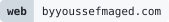
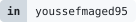
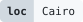
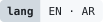
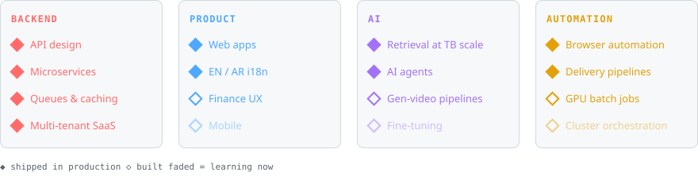

<picture>
  <source media="(prefers-color-scheme: dark)" srcset="assets/hero-dark.svg">
  
</picture>

  <a href="https://byyoussefmaged.com"><picture><source media="(prefers-color-scheme: dark)" srcset="assets/pill-web-dark.svg"></picture></a>
  <a href="https://www.linkedin.com/in/youssefmaged95"><picture><source media="(prefers-color-scheme: dark)" srcset="assets/pill-in-dark.svg"></picture></a>
  <picture><source media="(prefers-color-scheme: dark)" srcset="assets/pill-loc-dark.svg"></picture>
  <picture><source media="(prefers-color-scheme: dark)" srcset="assets/pill-lang-dark.svg"></picture>

### The stack, in orbit

  <picture>
    <source media="(prefers-color-scheme: dark)" srcset="assets/orbit-dark.svg">
    
  </picture>

### Last 12 months, wrapped

<picture>
  <source media="(prefers-color-scheme: dark)" srcset="assets/wrapped-dark.svg?v=6de8f2c0">
  
</picture>

### Talent tree

<picture>
  <source media="(prefers-color-scheme: dark)" srcset="assets/tree-dark.svg">
  
</picture>

### By the numbers

<picture>
  <source media="(prefers-color-scheme: dark)" srcset="assets/numbers-dark.svg?v=eb022845">
  
</picture>

Numbers refresh nightly from private work. Only totals are published, never repo names.

